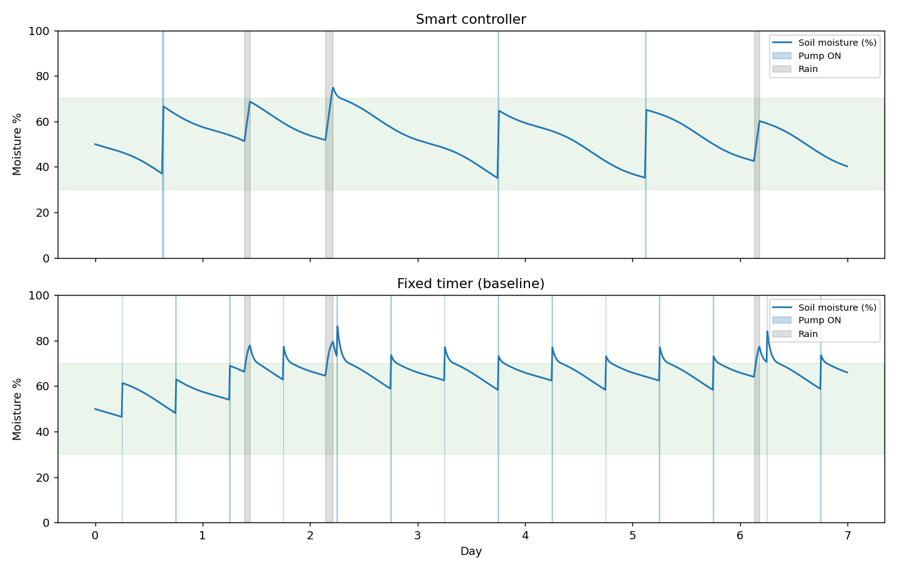

# 🌱 Smart Automatic Irrigation System

A Python project that decides **when to water a field** using soil moisture, temperature and rain forecast, and compares itself against a traditional fixed timer. It runs entirely as a simulation (no hardware needed) and also includes an Arduino sketch showing how the same logic runs on real hardware.

> **VITyarthi Project** · Name: `[Your Name]` · Reg. No: `[Your Reg No]` · Course: `[Course Name]`

---

## ✨ Features

- **Threshold control with hysteresis**: pump starts at ≤ 35 % moisture and stops at ≥ 65 %, so it doesn't rapidly switch on/off.
- **Rain-aware**: skips watering when rain is forecast (≥ 60 % chance).
- **Heat-aware**: waters earlier when temperature is ≥ 35 °C.
- **Safety rules**: maximum pump runtime (20 min), cool-down gap (60 min), and a **fail-safe** that shuts the pump off on a faulty sensor reading.
- **Baseline comparison**: a fixed twice-a-day timer is simulated on the same weather.
- **CSV logs + graph** for analysis.
- **9 unit tests** for the control logic.
- **Arduino Uno sketch** for a real prototype.

## 📁 Project Structure

```
smart-irrigation-system/
├── main.py                    # CLI entry point
├── irrigation/
│   ├── __init__.py
│   ├── config.py              # all tunable parameters
│   ├── controller.py          # smart controller + fixed-timer baseline
│   ├── simulator.py           # soil / weather model + simulation loop
│   └── logger.py              # CSV output
├── tests/test_controller.py   # unit tests
├── hardware/arduino_irrigation.ino
├── results/                   # generated logs and graph
├── PROJECT_REPORT.md
├── PROJECT_DESCRIPTION.md
├── requirements.txt
├── LICENSE
└── README.md
```

## 🚀 Getting Started

**Requirements:** Python 3.8+ (the core simulator uses only the standard library).

```bash
git clone https://github.com/<your-username>/smart-irrigation-system.git
cd smart-irrigation-system

# optional: for graphs and tests
pip install -r requirements.txt

python main.py                       # 7-day simulation
python main.py --days 14 --seed 7    # custom run
python main.py --plot                # also saves results/moisture_plot.png
```

### Run the tests

```bash
python -m pytest -v
```

## 📊 Sample Output

```
Simulated 7 day(s), seed=42, rain events=3

== Smart controller ==
  Water used        : 120.0 L
  Pump cycles       : 3
  Time in 30-70 %   : 98.6 %

== Fixed timer baseline ==
  Water used        : 280.0 L
  Pump cycles       : 14
  Time in 30-70 %   : 83.7 %

Water saved by smart controller: 160.0 L (57.1 %)
```

Averaged over 30 random weather seeds (7 days each), the smart controller used **~41 % less water** and kept the soil in the healthy 30–70 % band **98 %** of the time versus 85 % for the timer.



## 🧠 How It Works

```
Sensor reading ─► Validate ─► Pump running? ─► stop at target / max runtime
                     │              │
                  (fault → OFF)     └─ no ─► moisture ≤ threshold?
                                               ├─ rain expected → skip
                                               ├─ cooldown active → wait
                                               └─ else → START pump
```

Change behaviour by editing `irrigation/config.py`.

## 🔧 Hardware Version (optional)

Parts: Arduino Uno, capacitive soil-moisture sensor, 5 V relay module, small DC water pump + power supply. Wiring and calibration notes are in `hardware/arduino_irrigation.ino`.

## 🔮 Future Work

Real weather API, ESP32 + Wi-Fi/MQTT dashboard, multi-zone irrigation, ML-based moisture prediction, solar power.

## 📄 License

MIT: see [LICENSE](LICENSE).
